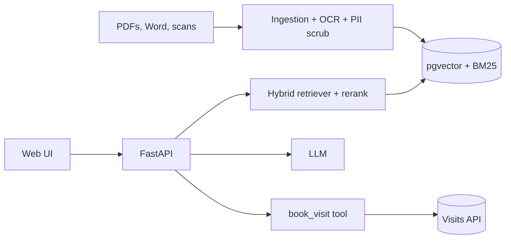

<!-- An example one-page architecture for the agency assistant. Read it section by section; the panel on the left explains what each part does. -->

# Architecture

## Overview
A local document assistant for a real estate agency in Sousse. Agents paste a client message and get an answer with citations from the agency's documents, and can book a visit. It runs on the office PC with Docker, with an optional API model.

## Components
- Ingestion: parses PDFs, Word files and scans (OCR), scrubs PII, chunks by sentence.
- Index: pgvector for embeddings (bge-m3 via Ollama) plus a BM25 index on normalized, stemmed text.
- Retriever: hybrid search with RRF, then a reranker.
- Generator: an LLM answering only from cited chunks.
- Action tool: book_visit through the agency's visits API, with confirmation.
- API: FastAPI with /ask, /chat and /feedback.
- UI: one HTML page, right-to-left aware.

## Diagram

## Data flow
1. The agent pastes "Combien de mois de caution ?" in the UI.
2. The API normalizes the text, detects French, and scrubs PII.
3. Hybrid search returns the top 20 chunks; the reranker keeps 5.
4. The LLM answers from the 5 numbered chunks and cites [1] to [5].
5. The API checks the citations, and the UI shows the answer with the source page.

## Storage
Raw files stay in a local folder. Chunks, vectors and feedback live in Postgres. Logs keep timings and the masked question only. Phone numbers, CINs and names are never stored in the index or logs.

## Decisions
- Local bge-m3 embeddings instead of an embeddings API, because the documents contain client data.
- Hybrid search instead of vectors only, because Phase 1 showed +7 points of recall on names and dates.

## Risks
- Scanned contracts with bad OCR: measure OCR quality per page and flag low-quality pages for manual review.
- Clients write Arabizi: detect it and measure how often; fall back to "I don't know" rather than guess.
