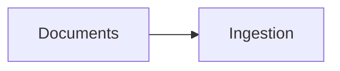

# Architecture

## Overview
<!-- TODO: 2-3 sentences: what the system does, for whom, running where (laptop, office PC, cloud). -->

## Components
<!-- TODO: one bullet per component (at least 5): ingestion, PII scrubber, index (pgvector), retriever, LLM, API, UI, action tool... -->

## Diagram
<!-- TODO: a Mermaid flowchart with at least 5 arrows. Bench and GitHub both render it.

-->

## Data flow
<!-- TODO: numbered steps of one question, from the user's message to the answer with citations (at least 4). -->

## Storage
<!-- TODO: what is stored where (raw files, chunks, vectors, feedback, logs) and what is NOT stored (PII). -->

## Decisions
<!-- TODO: at least 2 bullets "X instead of Y, because Z" (e.g. local embeddings instead of an API, because of the privacy constraint). -->

## Risks
<!-- TODO: at least 2 bullets: what could fail, and what you'll do about it. -->
