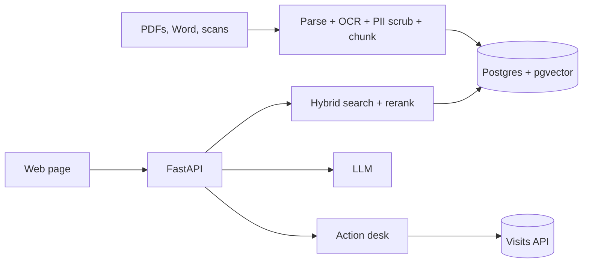

# Dar Assistant: document Q&A for a real estate agency
<!-- An example README for the project repository. Read it section by section; the panel on the left explains what each part does. -->
A local assistant that answers agents' client questions in Arabic, French, English and Derja from the agency's own documents, with citations, and books visits after confirmation.


## What it does
- Answers questions about fees, deposits, documents, visits and contracts from 120 agency documents, including scanned contracts.
- Shows the source of every fact: document title and article.
- Says "I don't know" when the documents don't answer.
- Books a visit through the agency's visits API, only after the agent confirms the preview.
- Keeps phone numbers, ID numbers and names out of the index, the logs and any API call.

## Architecture

Documents are indexed incrementally from a folder. Each question is scrubbed, searched with vectors and BM25, reranked, and answered from numbered sources whose citations are checked before display.

## Quickstart
```bash
git clone https://github.com/OussemaBouchaala/dar-assistant.git
cd dar-assistant
cp .env.example .env            # then edit the values
docker compose up -d --build
docker compose exec ollama ollama pull bge-m3
docker compose exec api python -m app.indexer /data/docs
python scripts/smoke_test.py http://localhost:8000
```
Then open http://localhost:8000.

## Configuration
| variable | default | description |
|---|---|---|
| `DATABASE_URL` | required | Postgres connection string |
| `OLLAMA_URL` | http://ollama:11434 | embedding and local model server |
| `LLM_PROVIDER` | ollama | ollama or anthropic |
| `LLM_API_KEY` | empty | API key when the provider is an API |
| `TOP_K` | 5 | chunks sent to the model |
| `RERANK` | true | rerank the top 20 before keeping TOP_K |

## Evaluation
On 42 test questions (5 languages, 8 categories), opened once:

| config | correct | citations | p95 s | USD / query |
|---|---|---|---|---|
| API small + hybrid + rerank | 0.86 [0.74, 0.95] | 0.93 [0.83, 1.00] | 7.4 | 0.0041 |
| local qwen2.5:7b + hybrid + rerank | 0.79 [0.64, 0.90] | 0.90 [0.79, 0.98] | 9.2 | 0.0009 |

Full report, failure analysis and costs: [results.md](docs/results.md).

## Limitations
- 42 test questions: scores are about plus or minus 10 points.
- Arabizi questions are detected but poorly answered.
- Tested on one agency's documents only.
